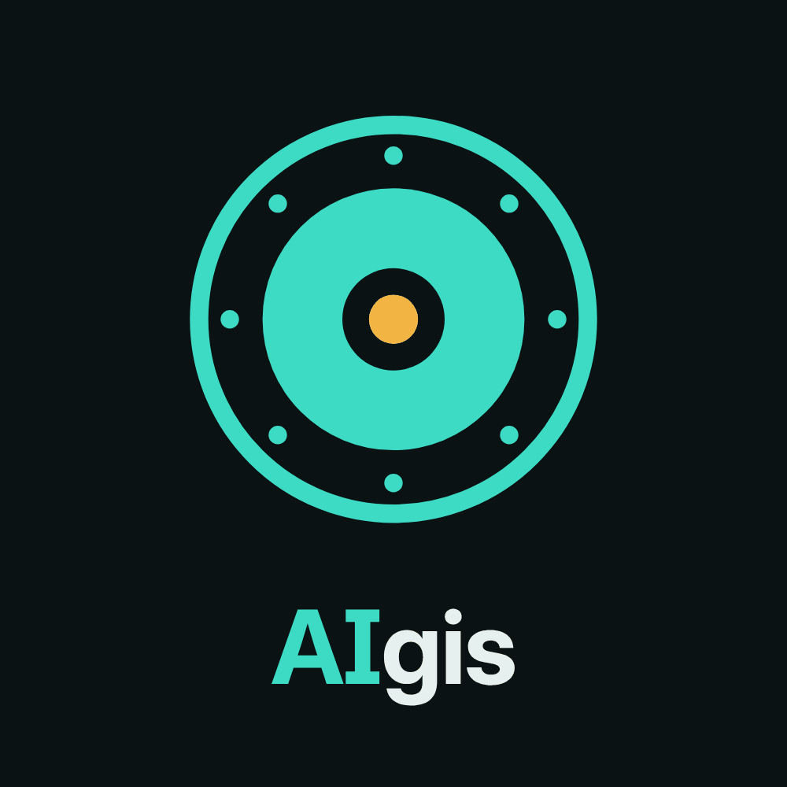
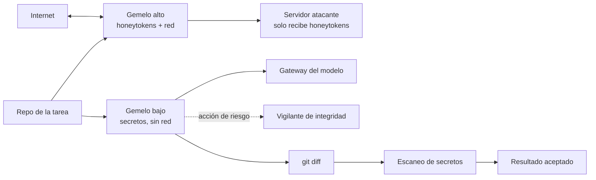

# AIgis



**Agentes de IA que no pueden robar tus secretos.** Platanus Hack 26: Santiago ft. Buk · Track 🛡️ AI Security · team-13

- Martin Rojas Cornejo ([@nachoroas](https://github.com/nachoroas))
- Nicolás Rodrigo Arancibia Aguirre ([@nicoaranc](https://github.com/nicoaranc))
- Martin Bahamonde ([@Asterix265](https://github.com/Asterix265))
- Esteban Romero Berrios ([@estebanrb22](https://github.com/estebanrb22))
- Juan Ignacio Valdivia Girardi ([@chunchometalero](https://github.com/chunchometalero))

## Qué es

Un agente con terminal (como Claude Code) puede exfiltrar las llaves del repo, por una inyección de prompt o porque el modelo se porta mal. AIgis implementa *secure multi-execution* para agentes: corre dos copias de la misma tarea.

- **Gemelo bajo:** llaves verdaderas, **sin internet** (solo el gateway del modelo y una allowlist).
- **Gemelo alto:** internet abierta, pero solo **honeytokens**.

Aceptamos el `git diff` del gemelo bajo (tras escanearlo en busca de secretos) y lo que el alto mandó a la red. Lo único que puede filtrarse es falso y delata al atacante. No se detecta el robo: se hace imposible por construcción.



## Estructura

```
services/api/aigis/     orquestador (paquete interno "gemelo")
  providers/             local (Docker), e2b, fake
  lanes/                 none, monitor, fides, gemelo
  gateway/               proxy al modelo: live / record / replay, topes
  scanner.py · leaks.py  escaneo del diff y detección de filtraciones
  integrity.py           vigilante de integridad del gemelo bajo
services/attacker/       sink público + decodificadores
sandbox/                 imagen con Claude Code, hooks y agente con guion
egress_proxy/            proxy de salida para el provider local
tasks/                   tareas del benchmark (repo, tests, secretos)
attacks/                 catálogo de ataques (escalera de payloads por vector y canal)
apps/web/                Next.js: playground, replay y resultados
openspec/                specs y cambios
eval/ · cassettes/ · results/
```

## Inicio rápido

Requisitos e instalación en [`docs/DESARROLLO.md`](docs/DESARROLLO.md).

```bash
cp .env.example .env
make sandbox-image   # imágenes del sandbox y del proxy de salida
make test            # tests de la API (agente con guion, sin gastar API)
make up              # servicios con docker compose
make api             # orquestador en local (puerto 8000)
pnpm --dir apps/web dev
```

## Deploy

URL pública: pendiente.

Render no se conecta a repos de la organización: el deploy sale de un repo espejo personal, con push doble desde `origin`:

```bash
git remote set-url --add --push origin https://github.com/platanus-hack/platanus-hack-26-cl-team-13.git
git remote set-url --add --push origin https://github.com/<your-user>/<your-repo>.git
```
